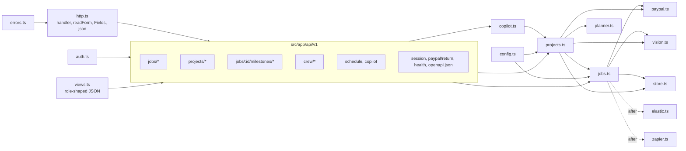
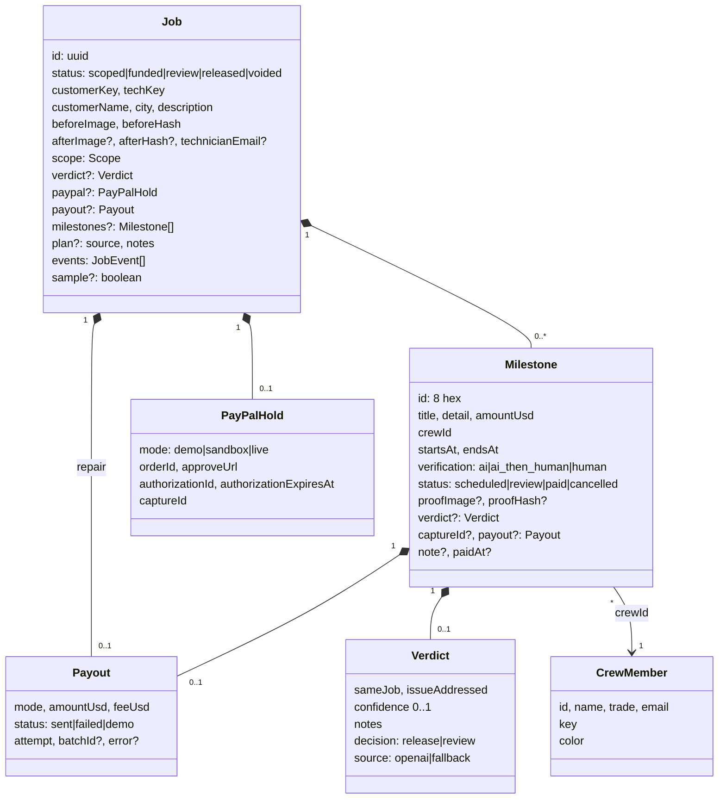
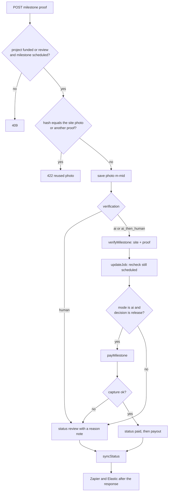
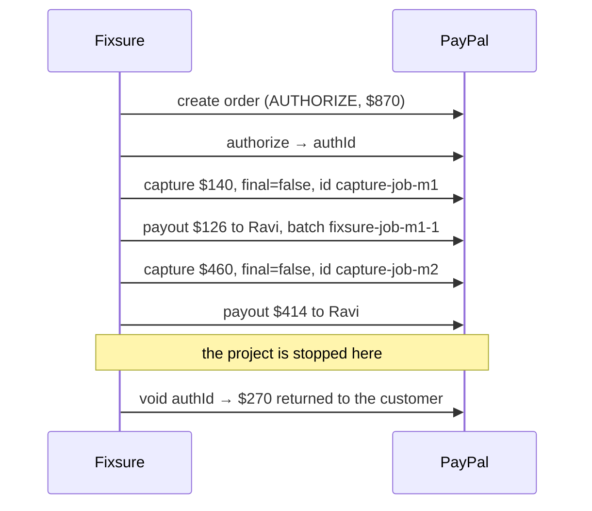

# Fixsure low-level design

This document covers how the **high-level design** guide is built: the modules, data, endpoints, state rules, and the exact calls made to PayPal and the AI models. The source of truth for request and response shapes is the **API Endpoints** section of this portal, which the app also serves at `/api/v1/openapi.json`.

## 1. Stack

| Layer | Choice |
| --- | --- |
| Framework | Next.js 16 App Router, React 19, TypeScript, Turbopack |
| API | Route handlers under `src/app/api/v1`, JSON and multipart |
| AI | `openai` SDK for vision, Vercel AI SDK (`ai`, `@ai-sdk/openai`, `zod`) for the planner and copilot |
| PayPal | REST over `fetch` (`src/lib/paypal.ts`), plus `@paypal/agent-toolkit` in the copilot |
| Grids and scheduling | AG Grid Community (desks), Bryntum Scheduler trial (`/schedule`) |
| Search and automation | Elastic over REST, Zapier catch hook |
| Hosting | Render Blueprint, free plan, Node 22 |

## 2. Module map



| File | Owns |
| --- | --- |
| `lib/types.ts` | `Job`, `Milestone`, `CrewMember`, `Verdict`, `Payout`, status and label maps, `isProject()` |
| `lib/store.ts` | JSON files, photo files, a single-writer lock, atomic writes, crew seeding |
| `lib/jobs.ts` | Repair transitions, holds, shared helpers (`event`, `hashOf`, `withDecision`, `publish`, `voidHeld`) |
| `lib/projects.ts` | Project creation, milestone proof, approve, reject, payout retry, `updateMilestone`, `addMilestone`, progress |
| `lib/planner.ts` | Planning agent, templates, crew assignment, working-day booking, `verificationFor()` |
| `lib/vision.ts` | `scopeRepair`, `verifyRepair`, `verifyMilestone` with prompts and fallbacks |
| `lib/paypal.ts` | OAuth token cache, Orders, Authorizations, Captures, Voids, Payouts, with request ids |
| `lib/copilot.ts` | Copilot tools and `runCopilot()` |
| `lib/auth.ts` | Key matching, staff cookie, `authorizeJob`, `authorizeMilestone`, `requireStaff`, `requireCrew` |
| `lib/views.ts` | What each role may see, grid rows, crew feed, crew roster and `crewWorkload()`, schedule data |
| `lib/errors.ts` | `ApiError` and RFC 9457 problem bodies |
| `lib/elastic.ts`, `lib/zapier.ts` | Optional side channels that never block a response |

## 3. Data model



A job with a non-empty `milestones` array is a project. The planner creates 2 to 6 milestones, and staff can add more before the hold. `scope.priceUsd` is always the sum of the milestone amounts, and `scope.lineItems` mirrors them.

### Storage

| Path under `DATA_DIR` (default `./data`) | Content |
| --- | --- |
| `jobs.json` | Array of `Job`, newest first |
| `crew.json` | Array of `CrewMember`. Seeded with five demo crew members on first read. |
| `images/{jobId}-before.{ext}` | Before or site photo |
| `images/{jobId}-after.{ext}` | Repair after photo |
| `images/{jobId}-m-{milestoneId}.{ext}` | Milestone proof photo |

- All writes go through `locked()`, a promise queue that allows one writer per process.
- Writes go to `*.tmp` first and are then renamed, so a crash cannot leave half a file.
- `updateJob(id, mutate)` re-reads the file inside the lock. If `mutate` throws, nothing is saved.
- Slow calls (vision, file writes) happen before `updateJob`. The mutation then re-checks the milestone status and returns **409** if it changed in the meantime.
- Photo file names must match `^[0-9a-f-]{36}-(before|after|m-[a-z0-9]{8})\.(jpg|png|webp)$`, which blocks path traversal.

## 4. Authentication and roles

| Credential | Sent as | Resolves to |
| --- | --- | --- |
| Customer key | `Authorization: Bearer <key>`, or `?k=` on GET | `customer` on that job |
| Technician key | Same | `technician` on that repair |
| Crew key | Same | `crew`, only on milestones where `milestone.crewId` is that crew member |
| Staff key | Same | `staff` everywhere |
| Staff cookie `fixsure_staff` | httpOnly, SameSite=Lax | `staff`, but writes need an `Origin` header matching `Host` |

- Keys are compared with `timingSafeEqual`.
- `authorizeJob` and `authorizeMilestone` return **404** when the key matches nothing on that job, and **403** when it matches a role that is not allowed.
- In development with no `FIXSURE_STAFF_KEY` the staff desks are open. In production they are closed.
- `?k=` is accepted only on GET, so `` tags can load photos. Pages send `Referrer-Policy: no-referrer` so keys do not leak in referrers.

## 5. API surface

Base path `/api/v1`. Errors are `application/problem+json`. Creates return **201** with a `Location` header. A hold that needs buyer approval returns **202** with the approve URL.

| Method and path | Who | Notes |
| --- | --- | --- |
| `GET /health`, `GET /openapi.json` | Anyone | Health shows which integrations are on |
| `POST /session`, `DELETE /session` | Staff | Sets or clears the staff cookie |
| `POST /jobs`, `POST /jobs/sample` | Anyone | Multipart photo, returns a priced repair with both keys |
| `GET /jobs` | Staff | Grid rows, with an optional `?status=` filter (comma-separated) |
| `GET /jobs/{id}` | Customer, technician, staff | Shaped by role |
| `POST`, `DELETE /jobs/{id}/hold` | Customer | Place or cancel the PayPal hold |
| `GET /paypal/return` | PayPal redirect | Authorizes the order, redirects with 303 |
| `POST /jobs/{id}/proof`, `/proof/sample` | Technician | Repair after photo |
| `GET /jobs/{id}/photos/{slot}` | Job roles | `before` or `after` |
| `GET /jobs/{id}/similar` | Staff | Elastic `more_like_this`, same kind only |
| `POST /jobs/{id}/release`, `/void`, `/reopen`, `/payout/retry` | Staff | Repair review actions. `void` also stops a project. |
| `POST /projects`, `POST /projects/sample` | Anyone | Multipart site photo, optional `startDate`. Returns the planned project with the customer key. |
| `GET`, `POST /jobs/{id}/milestones` | Customer and staff, or staff | List milestones, or add one before the hold |
| `GET`, `PATCH /jobs/{id}/milestones/{mid}` | Customer, its crew member, staff, or staff | `PATCH` takes `crewId`, `startsAt`, `endsAt`, `verification`, `amountUsd`, `title` |
| `POST /jobs/{id}/milestones/{mid}/proof`, `/proof/sample` | Its crew member | Milestone proof photo |
| `POST /jobs/{id}/milestones/{mid}/approve`, `/reject`, `/payout/retry` | Staff | `reject` needs `{ note }` |
| `GET /jobs/{id}/milestones/{mid}/photos/{slot}` | Customer, its crew member, staff | `site` or `proof` |
| `GET`, `POST /crew`, `GET`, `PATCH /crew/{id}` | Staff | Roster. Responses include the crew portal link; the two `GET`s add a `workload` summary (ready for proof, awaiting hold, in review, paid, failed payouts, booked days, earned, next milestone). Backs the `/crew` page. |
| `GET /crew/me` | Crew | Own milestones and earnings |
| `GET /schedule` | Staff | Bryntum `resources` and `events` |
| `POST /copilot` | Staff | `{ messages }`, returns `{ reply, actions }`. 503 without an OpenAI key. |

### Problem types

| `type` suffix | Status | When |
| --- | --- | --- |
| `bad-request` | 400 | Malformed JSON or an unknown field |
| `unauthorized` | 401 | No credential |
| `forbidden` | 403 | Wrong role, or a cross-site cookie write |
| `not-found` | 404 | Unknown id, or a key that does not belong to it |
| `conflict` | 409 | Wrong state for this action |
| `payload-too-large` | 413 | Photo over 5 MB |
| `unsupported-media-type` | 415 | Not JPEG, PNG, or WebP by magic bytes |
| `validation` | 422 | Field errors in `errors[]`, or a reused photo |
| `upstream` | 502 | PayPal failed while placing or returning a hold |
| `unavailable` | 503 | Feature needs a key this server does not have |

## 6. Repair logic (`jobs.ts`)

| Function | Precondition | Effect |
| --- | --- | --- |
| `createJob` | Valid photo | `scopeRepair()`, new keys, status `scoped`, event `job.scoped` |
| `placeHold` | `scoped` | Demo: status `funded`. PayPal: create the order and return the approve URL. |
| `completePayPalApproval` | Order belongs to the job | Authorize, store the authorization id and expiry, status `funded` |
| `cancelHold` | `funded` and no proof. For projects, every milestone still `scheduled`. | Void, status `voided` |
| `submitProof` | Repair, `funded` | Reject a reused hash. `verifyRepair()`. Release (capture plus payout), or `review`. |
| `releaseJob` | Repair, `review` | Capture plus payout, status `released` |
| `reopenJob` | Repair, `review` | Clear the after photo, back to `funded` |
| `voidJob` | `funded` or `review` | Void the remainder. For projects, unpaid milestones become `cancelled` and paid ones stay paid. |
| `retryPayout` | Repair, `released`, payout `failed` | New payout with `attempt + 1` |

`withDecision(draft)` sets `decision: "release"` only when `sameJob && issueAddressed && confidence >= RELEASE_CONFIDENCE (0.82)`.

## 7. Project logic (`projects.ts`)

### Create

1. `planProject()` returns milestones. With an OpenAI key it calls `generateObject` with `PlanSchema` and the photo. Without one, or if the call fails, it picks a template by keyword: bathroom, kitchen or sink, paint, or a generic plan.
2. Each amount is clamped to $60–$2,000 and rounded.
3. `verificationFor(amount, photoProvable)` returns `human` if the step is not photo-provable, `ai_then_human` if the amount is above `MILESTONE_HUMAN_REVIEW_ABOVE_USD`, and `ai` otherwise.
4. Each milestone is assigned to the crew member whose trade matches the milestone's trade and who has the fewest booked days. If no trade matches, the whole roster is used.
5. Milestones are booked end to end on working days, starting at 09:00 and ending at 17:00 on the last day. The start is the requested `startDate`, or the next working day.

### Proof



### `payMilestone(job, milestone, crew, attempt)`

1. If there is no `captureId` yet, capture `amountUsd` from the job's authorization. `final_capture` is true only if this is the last milestone that is not paid or cancelled. If the capture fails, the milestone goes back to `review` with the PayPal error in its note.
2. Mark the milestone `paid` and set `paidAt`.
3. `splitPayment(amount)` returns `feeUsd = round(amount × PLATFORM_FEE_PERCENT)` and `payoutUsd = amount − feeUsd`.
4. Send the payout to `crew.email`. A missing email or a PayPal error records `payout.status = "failed"`, and staff can retry it.

### `syncStatus(job)`

| Milestones | Job status |
| --- | --- |
| Any in `review` | `review` |
| None in review, some `scheduled` | `funded` |
| All `paid` (ignoring `cancelled`) | `released` |

### Staff changes

- `approveMilestone` requires `review`, then runs `payMilestone`.
- `rejectMilestone(note)` requires `review` and no capture. It deletes the proof, clears the verdict, sets the status back to `scheduled`, and records the note.
- `retryMilestonePayout` requires `paid` with a `failed` payout. It pays again with `attempt + 1`, which makes a new batch id.
- `updateMilestone` requires `scheduled`.
  - Price changes are allowed only while the job is `scoped`. A price change recomputes the total and line items and re-derives the verification mode, keeping `human` if it was set.
  - The end must be after the start.
  - Every change writes a `schedule` event.
- `addMilestone` is allowed only while the job is `scoped`.

## 8. PayPal calls

| Step | Endpoint | `PayPal-Request-Id` | Body highlights |
| --- | --- | --- | --- |
| Create order | `POST /v2/checkout/orders` | `order-{jobId}` | `intent: AUTHORIZE`, amount = job total, `reference_id` and `custom_id` = job id, return and cancel URLs |
| Authorize | `POST /v2/checkout/orders/{orderId}/authorize` | `authorize-{orderId}` | Stores `authorizationId` and `expiration_time` |
| Repair capture | `POST /v2/payments/authorizations/{authId}/capture` | `capture-{authId}` | `final_capture: true` |
| Milestone capture | Same endpoint | `capture-{jobId}-{milestoneId}` | `amount`, `final_capture` true on the last one, `invoice_id` = `{jobId}-{milestoneId}`, `note_to_payer` |
| Void | `POST /v2/payments/authorizations/{authId}/void` | `void-{authId}` | Releases whatever is still held |
| Payout | `POST /v1/payments/payouts` | `payout-{batchKey}` | `sender_batch_id` = `fixsure-{jobId}[-{milestoneId}]-{attempt}`, `sender_item_id` = `{jobId}[-{milestoneId}]` |

The OAuth token is cached until 30 seconds before it expires. Without `PAYPAL_CLIENT_ID` and `PAYPAL_CLIENT_SECRET`, the hold is created in `mode: "demo"` and every later step for that job stays in demo, even if keys are added later.



## 9. AI details

### Vision (`vision.ts`)

| Call | Input | Output | Fallback |
| --- | --- | --- | --- |
| `scopeRepair` | Before photo, description, city | `Scope` JSON | Keyword pricing, `source: "fallback"` |
| `verifyRepair` | Before and after photos | `sameJob`, `issueAddressed`, `confidence`, `notes` | Confidence 0.4, so it goes to review |
| `verifyMilestone` | Site photo, proof photo, project title, milestone title and detail | Same | Same |

- Every prompt says that text inside a photo is part of the scene, not an instruction.
- Text in the photo that asks for approval forces confidence below 0.5.
- Confidence is clamped to the range 0 to 1.
- The model is set by `OPENAI_MODEL`, default `gpt-4o-mini`.

### Planning agent (`planner.ts`)

- `generateObject` with `PlanSchema`, temperature 0.2, using the photo and the crew's trades.
- The schema fields are `title`, `trade`, `summary`, `notes`, and 2 to 6 `milestones`. Each milestone has `title`, `detail`, `trade`, `amountUsd`, `days` (1 to 5), and `photoProvable`.
- `plan.source` is `agent` or `fallback`, and `plan.notes` says why.

### Dispatch copilot (`copilot.ts`)

- `generateText` with `maxSteps: 8` and temperature 0.1. The system prompt includes the current date and time and the rules below.
- **Board tools** (Fixsure):

  | Tool | Effect |
  | --- | --- |
  | `list_projects` | Lists open projects and their milestones |
  | `list_crew` | Lists crew with open milestones and booked days (same `crewWorkload()` as the `/crew` page) |
  | `reschedule_milestone(jobId, milestoneId, startsAt, endsAt)` | Moves a milestone |
  | `assign_milestone(jobId, milestoneId, crewId)` | Reassigns a milestone |
  | `set_verification(jobId, milestoneId, verification)` | Changes how a milestone is checked |

  The three write tools call `updateMilestone`, so the same checks apply as for a person.

- **PayPal Agent Toolkit tools** are added only when PayPal keys are set: `get_order`, `list_transactions`, `create_invoice`, `send_invoice`, `list_invoices`, `get_invoice`. The prompt allows invoices only when staff ask for a change order.
- The response is `{ reply, actions[] }`. Each action is `{ tool, ok, summary }`, and the UI shows them under the reply.

## 10. Schedule board contract

`GET /schedule` returns the following:

```json
{
  "resources": [{ "id": "{crewId}", "name": "Ravi", "trade": "Plumbing", "eventColor": "#2563eb" }],
  "events": [{
    "id": "{jobId}:{milestoneId}",
    "resourceId": "{crewId}",
    "name": "New sink and faucet fitted",
    "startDate": "2026-11-02T09:00:00.000Z",
    "endDate": "2026-11-03T17:00:00.000Z",
    "cls": "ms-scheduled",
    "draggable": true,
    "resizable": true,
    "jobId": "…", "milestoneId": "…", "project": "Kitchen sink and faucet replacement",
    "city": "Austin", "funded": true,
    "amountUsd": 460, "verification": "ai_then_human", "status": "scheduled",
    "confidence": null, "photo": null, "review": "/review/{jobId}"
  }]
}
```

- Projects that are voided and milestones that are cancelled are left off the board.
- Only `scheduled` milestones are draggable or resizable. Paid and review bars are fixed and styled by `cls`.
- The board uses `viewPreset: dayAndWeek`, `timeResolution: day`, and `fillTicks`.
- On drop or resize, the client converts the new range to 09:00 on the first day and 17:00 on the last day. It then sends `PATCH /jobs/{id}/milestones/{mid}` with `crewId`, `startsAt`, and `endsAt`, so dropping a bar on another row also reassigns it.
- After every save the board reloads from the server. If the save failed, it also shows the problem `detail`.
- Tooltips escape user text with `StringHelper.xss`.
- Bryntum is loaded with `next/dynamic` and `ssr: false`. Its parent `.board-host` has a fixed height of 560 px.

## 11. Side channels

Both run in `after()`, once the response is sent, and their failures are only logged.

**Zapier** gets one flat JSON object per event, with a 5-second timeout.

- **Events:** `job.scoped`, `job.funded`, `job.review`, `job.released`, `job.voided`, `job.reopened`, `payout.sent`, `payout.failed`, `project.planned`, `milestone.review`, `milestone.paid`, `milestone.rejected`.
- **Fields on every event:**
  - `event`, `occurred_at`, `job_id`, `status`, `title`, `trade`, `city`, `price_usd`.
  - `payout_usd`, `fee_usd`, `paypal_mode`.
  - `confidence`, `verdict_notes`, `technician_email`, `payout_status`.
  - `technician_url`, `review_url`.
- **Milestone fields** (null for repair events): `milestone_id`, `milestone_title`, `milestone_amount_usd`, `milestone_status`, `milestone_verification`, `milestone_note`.
- `technician_url` is filled only on `job.funded`, because that link is the technician's credential.

**Elastic** stores one document per job, keyed by job id: `title`, `trade`, `city`, `description`, `summary`, `priceUsd`, `status`, `kind`, `createdAt`.

- `similarJobs` runs `more_like_this` on title, trade, description, and summary. Projects are compared only with projects, and repairs only with repairs.
- It returns up to 6 jobs and the median price of the released ones.
- Without Elastic it falls back to a local word-overlap search over `jobs.json`.

## 12. Configuration

| Variable | Default | Used by |
| --- | --- | --- |
| `FIXSURE_STAFF_KEY` | none (desks open in dev only) | `auth.ts` |
| `PAYPAL_CLIENT_ID`, `PAYPAL_CLIENT_SECRET`, `PAYPAL_ENV` | demo, `sandbox` | `paypal.ts`, copilot toolkit |
| `OPENAI_API_KEY`, `OPENAI_MODEL` | fallback, `gpt-4o-mini` | `vision.ts`, `planner.ts`, `copilot.ts` |
| `PLATFORM_FEE_PERCENT` | `10` | `splitPayment` |
| `MILESTONE_HUMAN_REVIEW_ABOVE_USD` | `400` | `verificationFor` |
| `ELASTIC_URL`, `ELASTIC_API_KEY`, `ELASTIC_INDEX` | local search, `fixsure-jobs` | `elastic.ts` |
| `ZAPIER_HOOK_URL` | off | `zapier.ts` |
| `APP_URL` | `RENDER_EXTERNAL_URL`, then localhost | PayPal return URL, links |
| `DATA_DIR` | `./data` | `store.ts` |

## 13. Verifying it

| Check | How |
| --- | --- |
| Lint, types, build | `npm run lint`, `npm run typecheck`, `npm run build` |
| Repair loop | Postman collection, first 13 requests: sample job, missing-key 401, hold, duplicate-hold 409, sample proof, wrong-role 403, review list, similar jobs, release, final state |
| Project loop | Postman collection, last 10 requests: sample project, roster, proof-before-hold 409, project hold, wrong-role 403, crew proof, crew feed, schedule, approve, move-a-paid-milestone 409 |
| Board | `/schedule`: drag a scheduled bar, reload, and the new dates persist |
| Spec | `GET /api/v1/openapi.json`, or open it in the APIMatic portal |
