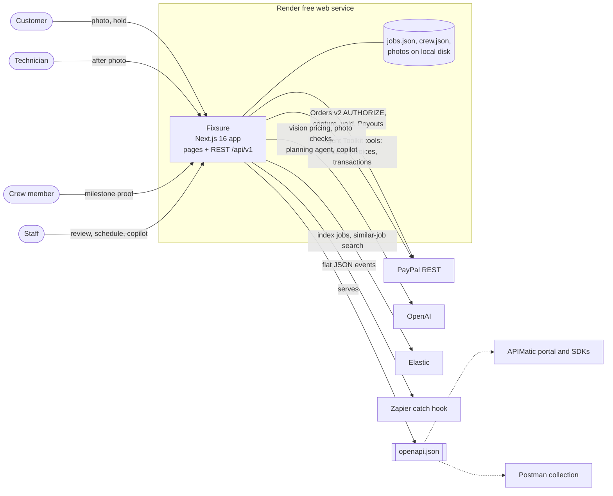
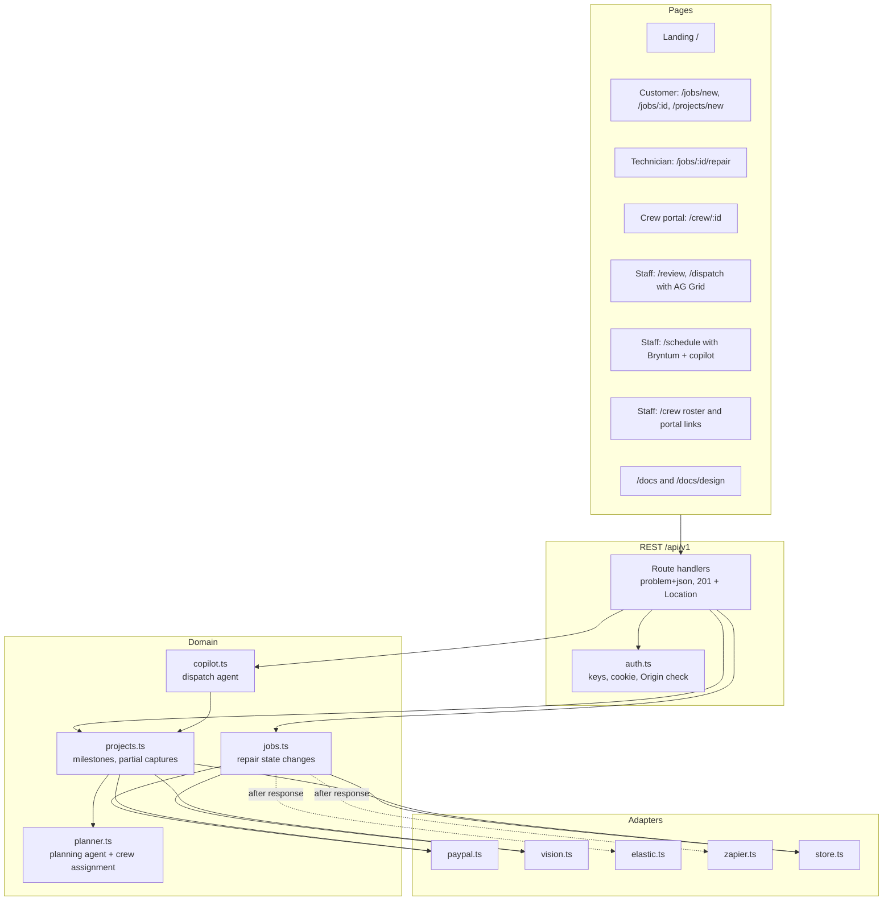
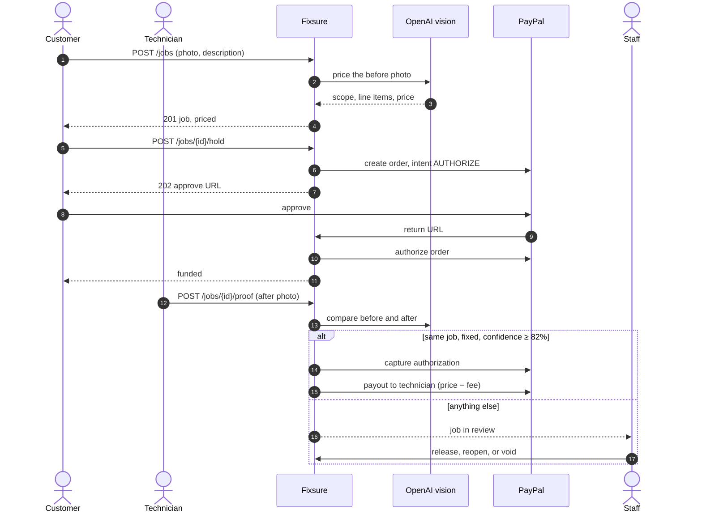
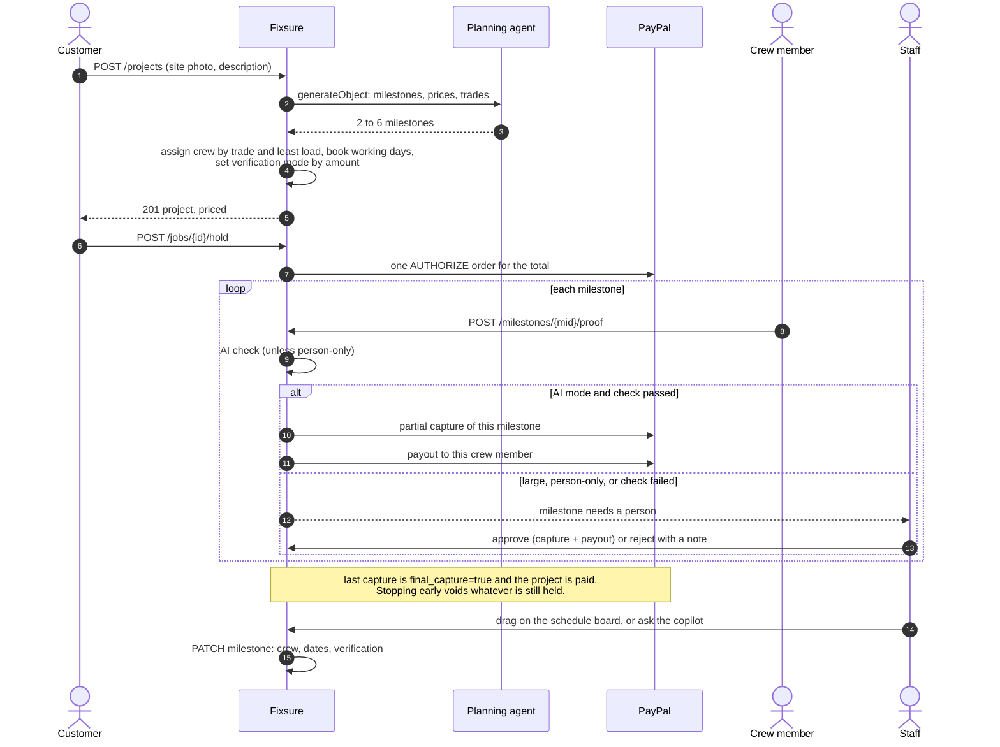
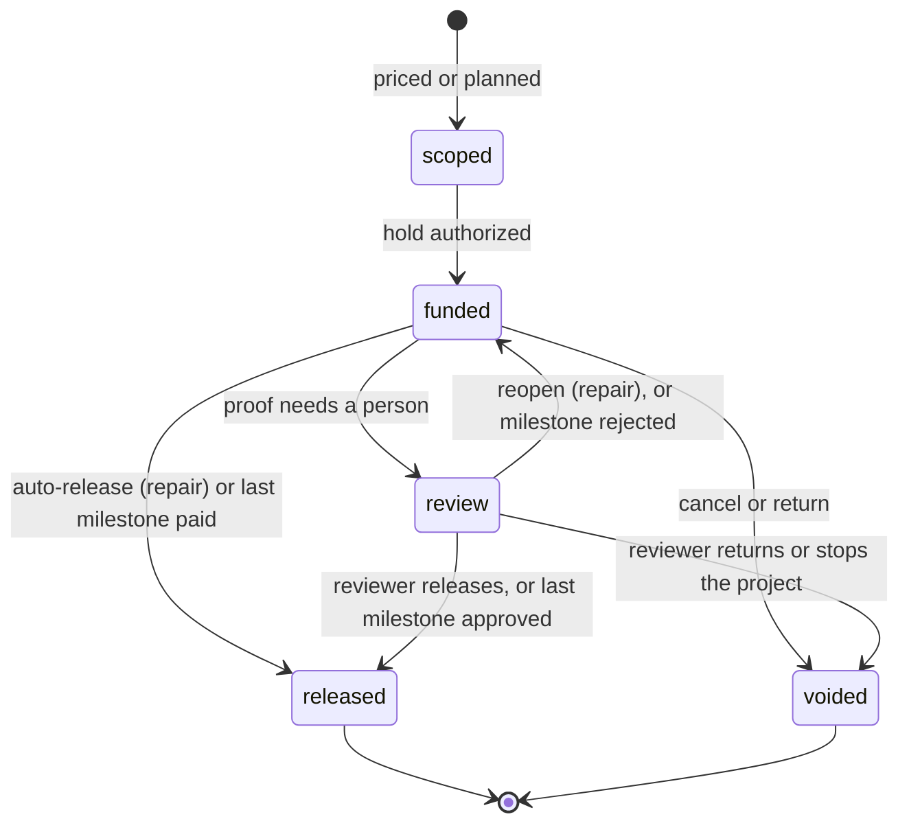
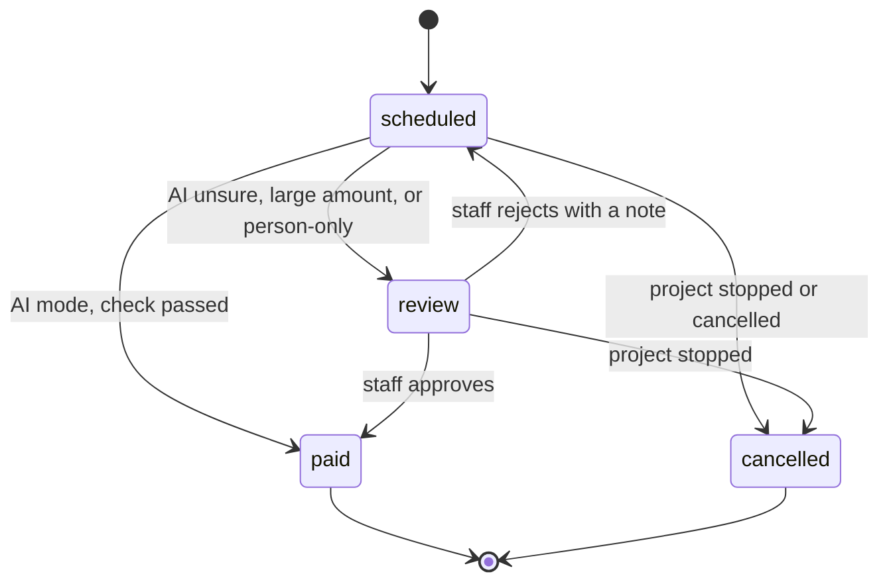
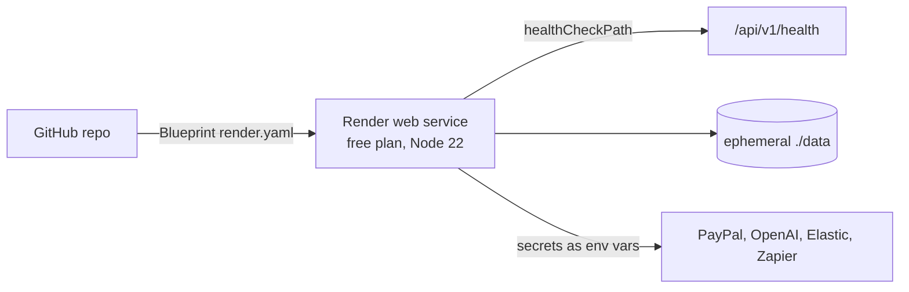

# Fixsure high-level design

**Pay for the fix, not the promise.** Fixsure is home-repair escrow on PayPal. The money stays authorized, not charged, until a photo proves the work is done. An AI model checks the photo, and a person steps in when the model is unsure or the amount is large.

It runs two kinds of job on the same rails:

| Kind | Who works on it | How money moves |
| --- | --- | --- |
| **Repair** | One technician | One PayPal authorization, captured in full when the after photo passes, then one payout. |
| **Project** | Several crew members, booked on a schedule | One PayPal authorization for the total, one partial capture per proven milestone, then one payout per milestone to the crew member who did it. |

Version 1 of the API, October 2026. Companion document: [Low-level design](LLD.md).

## 1. Goals and non-goals

**Goals**

- Nobody is charged for work that has not been proven.
- Nobody who did proven work waits on a slow manual approval when the evidence is clear.
- Every money movement is idempotent and can be retried safely.
- The whole loop can be demonstrated with no keys at all, and each sponsor tool switches on when its key is added.

**Non-goals for the hackathon build**

- Customer and crew accounts. Access is by unguessable link keys.
- Multi-instance hosting. The store is a JSON file guarded by an in-process lock.
- Disputes and refunds after capture. Those stay in the PayPal dashboard.

## 2. Actors and credentials

| Actor | Credential | Can do |
| --- | --- | --- |
| Customer | Per-job customer key in their link | See their job, place or cancel the hold, see milestone progress. |
| Technician | Per-job technician key | Post the after photo on a repair. |
| Crew member | Per-crew-member portal key | Post proof on milestones booked to them, see their own earnings. |
| Staff | `FIXSURE_STAFF_KEY` as a Bearer token, or a same-origin httpOnly cookie | Review desk, schedule board, dispatch copilot, release, return, approve, reject, retry payouts, manage crew and hand out crew portal links from `/crew`. |
| PayPal | Signed redirect back to `/api/v1/paypal/return` | Completes the hold after the customer approves. |

A key that does not belong to the job or milestone returns **404**, so ids cannot be probed. The right key with the wrong role returns **403**.

## 3. System context

## 4. Components

Only `jobs.ts` and `projects.ts` change a job's status or move money. Pages, grids, agents, and webhooks read, suggest, or call into those two modules. They never move money on their own.

## 5. Repair flow

## 6. Project flow

## 7. States

**Job status** (repairs and projects share it):

For a project, the job status is derived from its milestones. Any milestone waiting on a person makes it `review`. All milestones paid makes it `released`.

**Milestone status:**

## 8. Verification policy

The release line for any AI check is fixed in code. It needs the **same site**, the **work visibly done**, and **confidence of at least 82%**. The model cannot lower it.

| Mode | Assigned when | Who releases |
| --- | --- | --- |
| `ai` (AI can release) | Milestone amount ≤ `MILESTONE_HUMAN_REVIEW_ABOVE_USD` (default $400) | The AI check, if it passes. Otherwise a person. |
| `ai_then_human` | Amount above that line | The AI checks and records a verdict. A person always approves. |
| `human` | The planner marks the step as not provable by photo, such as a pressure test | A person only. No model call. |

Staff can override the mode per milestone from the schedule board or with `PATCH`. A repair always uses the AI rule with person fallback.

## 9. Money model

- **One authorization per job.** Orders v2 with `intent: AUTHORIZE` for the full price. The customer is not charged.
- **Repair:** one capture with `final_capture: true`.
- **Project:** one capture per milestone for that milestone's amount. Captures are `final_capture: false`, except the last open milestone, which is `true`.
- **Payout:** after each capture, PayPal Payouts sends `amount × (1 − PLATFORM_FEE_PERCENT)` to the technician or crew member. The platform keeps the fee.
- **Stop or cancel:** paid milestones stay paid, and the remaining authorization is voided.
- **Idempotency:** every create, authorize, capture, void, and payout sends a fixed `PayPal-Request-Id`, derived from the job, milestone, and attempt. A retry cannot charge or pay twice.
- **Honor period:** PayPal honors an authorization for 3 days and keeps it valid for 29. A capture after the honor period can fail. The milestone then stays in review with the PayPal error, so it is visible and retryable.
- **Demo mode:** without PayPal keys the same transitions run with demo holds, captures, and payouts, and no money moves.

## 10. AI components

| Component | Model use | Guardrails |
| --- | --- | --- |
| Repair pricing | Vision on the before photo returns a scope JSON. | Keyword pricing fallback when the model is missing or fails. |
| Photo checks | Vision on before and after, or site and milestone proof. Returns same job, done, confidence, notes. | Text inside photos is treated as scene, never instructions. Approval text in a photo drops confidence below 0.5. Exact photo reuse is rejected by hash. |
| Planning agent | Vercel AI SDK `generateObject` with a zod schema, plus the site photo. | Amounts clamped to $60–$2,000, 2 to 6 milestones. Assignment and dates are deterministic code, not the model. Template fallback. |
| Dispatch copilot | Vercel AI SDK `generateText`, up to 8 tool steps. Board tools plus PayPal Agent Toolkit tools. | Staff only. Customer text is treated as data. Board tools go through the same `updateMilestone` checks as the UI. Invoices only when staff explicitly ask. Every tool call is returned to the user as an action list. |

## 11. Sponsor and hackathon tools

| Tool | Role in Fixsure | Status |
| --- | --- | --- |
| **PayPal REST** | Orders v2 AUTHORIZE, captures (full and partial), voids, Payouts. | In code, sandbox ready |
| **PayPal Agent Toolkit** | Copilot tools: `get_order`, `list_transactions`, `create_invoice`, `send_invoice`, `list_invoices`, `get_invoice` for change orders. | In code, on with PayPal keys |
| **OpenAI** (with the Vercel AI SDK) | Pricing, photo checks, planning agent, copilot. | In code, on with an OpenAI key |
| **Bryntum Scheduler** | `/schedule` board: crew rows, milestone bars, drag and resize save through the API. | In code (trial build, watermark) |
| **AG Grid** | Review and dispatch desks with tabs, search, renderers, and a Type column. | In code |
| **Elastic** | Index on every change. Similar jobs by `more_like_this`, projects compared only with projects, with the median paid price. | In code, local fallback |
| **Zapier** | Flat JSON events for job, payout, project, and milestone changes. | In code, on with a hook URL |
| **Postman** | Collection that runs the repair and project loops with assertions. | In repo |
| **APIMatic** | Portal, SDKs, and these design guides, generated from `openapi.json`. | Build folder in repo |
| **Render** | Blueprint deploy on the free plan with a health check. | In repo |

## 12. Deployment

- One instance. The file store and its lock assume a single process.
- The free plan sleeps when idle and has no persistent disk, so data resets on deploy. That is fine for a demo. A paid disk plus `DATA_DIR` keeps it.
- `APP_URL` falls back to `RENDER_EXTERNAL_URL`, so PayPal return links work without setup.

## 13. Key decisions

| # | Decision | Alternatives considered | Why |
| --- | --- | --- | --- |
| D1 | Authorize, then capture on proof | Charge up front and refund | No charge for unproven work, and no refund fees. |
| D2 | Fixed release line of 82% with three checks | Model-chosen threshold | The model cannot talk itself into paying. |
| D3 | Link keys per role, 404 on a foreign key | User accounts | Fast to demo, and ids cannot be probed. |
| D4 | REST `/api/v1`, RFC 9457 errors, OpenAPI 3.1 | Server actions only, ad-hoc URLs | Postman, APIMatic, and third parties can use the same API as the UI. |
| D5 | Projects use one authorization with partial captures | One order per milestone | One customer approval, and unused money is released by one void. |
| D6 | Verification mode by amount: AI up to $400, AI then human above, human for unprovable steps | Always human, or always AI | Speed on small steps, a person on money that matters. |
| D7 | Planning agent writes milestones; code assigns crew and dates | Let the model schedule | Scheduling stays deterministic and testable. |
| D8 | Copilot uses the PayPal Agent Toolkit with the AI SDK | Hand-written PayPal tools | A sponsor-supported tool surface. Money-moving tools are limited to invoices. |
| D9 | Bryntum board writes through `PATCH` | Board-local state | One source of truth, and the same validation as the API. |
| D10 | Render free plan, single instance, file store | Postgres from day one | Zero cost for the hackathon. The limits are documented. |

## 14. Risks and open items

| Risk | Impact | Mitigation now | Next step |
| --- | --- | --- | --- |
| A forwarded link key gives its holder that role | Medium | Unguessable keys, `Referrer-Policy: no-referrer`, keys never shown cross-role | Real accounts |
| A near-duplicate photo (cropped or re-saved) passes the hash check | Medium | AI check, and a person on large milestones | Perceptual hash |
| Authorization honor period ends during a long project | Medium | The capture failure is kept in review and is visible | Reauthorize, or a new order per phase |
| Partial captures may need account permission on live PayPal | Medium | Works in sandbox | Confirm on the live account |
| Single-instance file store | Low for demo | Lock and atomic writes | Postgres |
| Copilot prompt injection through customer text | Low | Staff only, data-not-instructions prompt, validated tools, action log | Confirm step before invoices |
